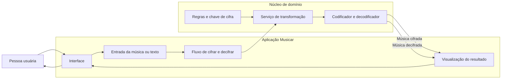

# Arquitetura do Musicar

> **Visão conceitual:** este diagrama descreve uma proposta de arquitetura baseada na descrição do repositório (“Cifrar músicas de forma original”). O repositório está vazio no momento; os componentes abaixo não representam funcionalidades já implementadas.

## Componentes propostos

- **Interface:** recebe o conteúdo e apresenta o resultado ao usuário.
- **Fluxo de cifrar e decifrar:** coordena a operação solicitada.
- **Serviço de transformação:** aplica as regras escolhidas ao conteúdo.
- **Regras e chave de cifra:** definem como a transformação é realizada; o formato ainda precisa ser especificado.
- **Codificador e decodificador:** transformam o conteúdo de entrada e permitem reverter a operação quando a regra/chave apropriada estiver disponível.

## Limites desta visão

O repositório ainda não contém código ou decisões técnicas que confirmem plataforma, armazenamento, sincronização ou serviços externos. Esses elementos foram deixados fora do diagrama para não pressupor escolhas de implementação. Atualize este documento quando a arquitetura real for definida.
